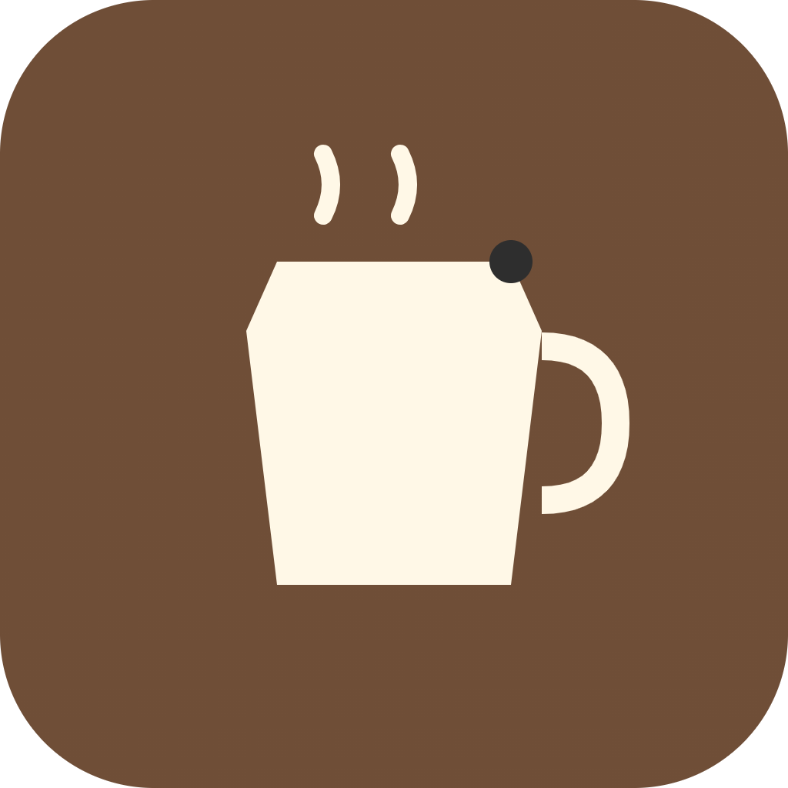

# CupClub


An NFT membership club that turns coffee lovers into a global community

## Overview
CupClub issues membership NFTs that unlock access to curated coffee drops, voting on which farms and roasters get featured, and in-person meetup perks at partner cafes. Members earn on-chain reputation points for reviews and attendance, redeemable for discounts or rare bean allocations. CupClub turns passive coffee fandom into an active, token-gated community, built for coffee enthusiasts, specialty cafes, and roasters who want a loyal, connected community.

## Problem
Coffee lovers lack a shared, portable way to show loyalty and influence across multiple independent cafes and roasters. Loyalty programs today are siloed per shop, so engagement and reputation built at one cafe mean nothing anywhere else.

## Solution
A single NFT membership works across a network of partner cafes and roasters, with on-chain reputation and DAO-style governance replacing siloed punch-cards. Members get one portable identity and voice across the whole community instead of being locked into a single shop.

## Features (MVP)
- Mint membership NFT tiers with different perks
- DAO-style voting on the next featured bean/farm drop
- On-chain reputation points for check-ins and reviews at partner cafes
- Partner cafe dashboard to redeem points/discounts via QR
- Marketplace for limited bean-drop NFTs tied to physical allocation

## Tech stack
- Chain: Solana
- Metaplex (NFT minting for memberships and bean drops)
- Anchor (on-chain programs for reputation and redemption)
- Realms (DAO voting on featured farms/roasters)
- Solana Pay (QR-based redemption at partner cafes)
- Next.js (web app)
- Phantom wallet adapter (wallet connection)

## How it works
```
[Member] --mint--> [Membership NFT via Metaplex]
 [Member] --vote---> [Realms DAO] --selects--> [Featured Farm/Drop]
 [Member] --checkin/review--> [Anchor Program] --records--> [On-chain Reputation]
 [Member] --redeem--> [Partner Cafe Dashboard] <--QR/Solana Pay--> [Discounts/Perks]
 [Member] --trade--> [Bean-Drop NFT Marketplace] --tied to--> [Physical Allocation]
```

## Roadmap
- Onboard a small network of 5-10 partner cafes
- Launch the first community-voted limited bean drop
- Add a secondary marketplace for membership tier upgrades

## Pitch
See our one-pager at [docs/pitch.pdf](docs/pitch.pdf) and the spoken pitch script at [docs/pitch-script.md](docs/pitch-script.md).

## Team
- [Name] - Role (placeholder)
- [Name] - Role (placeholder)
- [Name] - Role (placeholder)

Built for the Colosseum hackathon.

---

🎬 Pitch video: [docs/pitch-video.mp4](docs/pitch-video.mp4)


## Prototype

Live prototype: https://yuto1003-glitch.github.io/cupclub/

The source is [docs/index.html](docs/index.html) (served with GitHub Pages from the /docs folder). All data is simulated.
